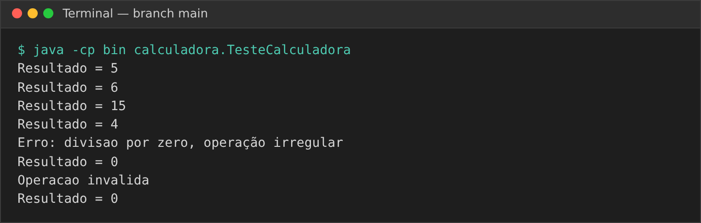
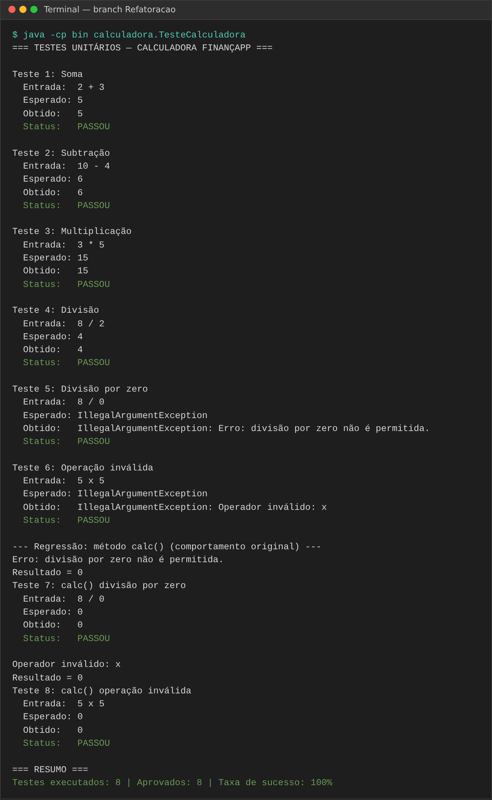
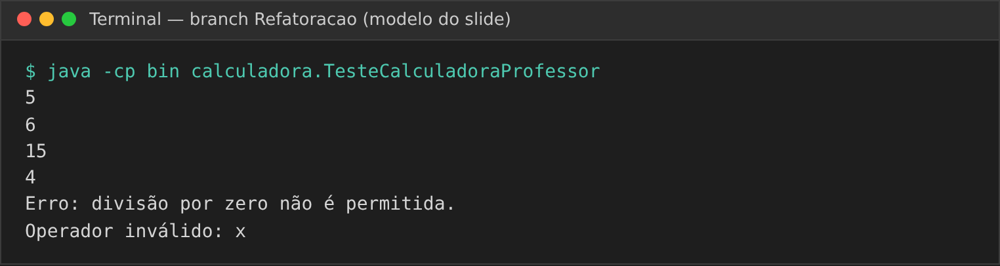
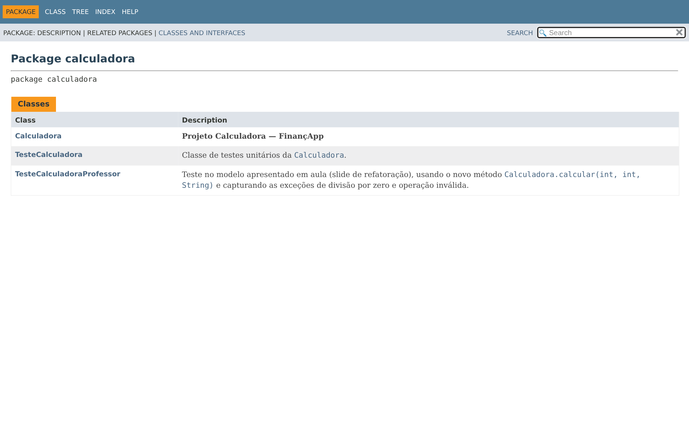
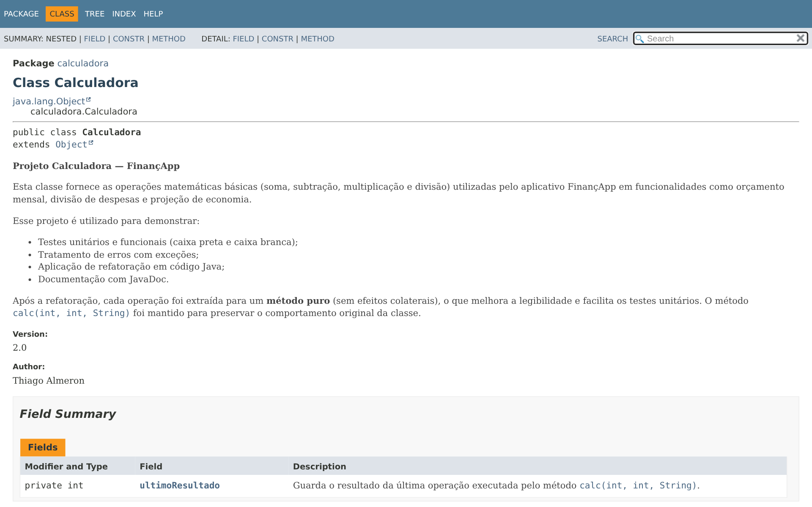
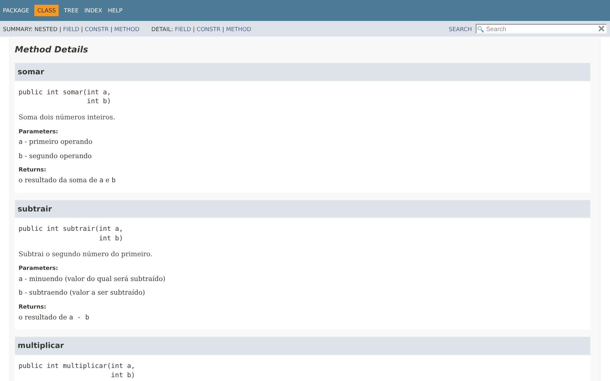

# Projeto Calculadora — FinançApp

> Projeto acadêmico desenvolvido com foco em Qualidade de Software, Testes, Refatoração, Documentação e Versionamento.

---

## 1. Identificação do Projeto

**Projeto:** Projeto Calculadora  
**Contexto:** FinançApp  
**Aluno:** Thiago Almeron  
**RA:** 249175  
**Curso:** Análise e Desenvolvimento de Sistemas  
**Disciplina:** UX/UI e Testes de Software (AS406TSN1)  
**Professor:** Daniel Ohata  
**Semestre:** 2026.2

---

# 2. Visão Geral

O projeto consiste no desenvolvimento de um módulo de cálculos matemáticos básicos em Java para a startup fictícia **FinançApp**.

O módulo foi desenvolvido com o objetivo de ser utilizado futuramente em funcionalidades de controle financeiro, como:

- orçamento mensal;
- divisão de despesas;
- projeções financeiras;
- cálculos auxiliares.

Além do funcionamento correto das operações, o projeto aplica práticas de qualidade de software relacionadas a:

- testes;
- tratamento de erros;
- refatoração;
- documentação;
- versionamento;
- manutenção de código.

---

# 3. Problema

Durante o desenvolvimento da aplicação FinançApp, foi identificada a necessidade de criar um módulo matemático reutilizável.

Entretanto, a equipe definiu que o módulo não deveria apenas funcionar corretamente, mas também apresentar:

- código legível;
- testes automatizados;
- tratamento de falhas;
- documentação técnica;
- controle de versões;
- facilidade de manutenção.

O desafio consiste, portanto, em desenvolver uma solução funcional e ao mesmo tempo aplicar boas práticas de Engenharia de Software.

---

# 4. Objetivo

## 4.1 Objetivo Geral

Desenvolver uma calculadora em Java aplicando práticas de qualidade, testes, documentação, refatoração e versionamento.

## 4.2 Objetivos Técnicos

- implementar operações matemáticas básicas;
- tratar entradas inválidas;
- impedir divisão por zero;
- desenvolver testes automatizados;
- refatorar o código sem alterar seu comportamento;
- documentar classes e métodos com JavaDoc;
- gerar documentação HTML;
- utilizar Git e GitHub;
- organizar commits e branches;
- manter documentação técnica no README.

---

# 5. Escopo Funcional

A aplicação deverá oferecer as seguintes operações:

| ID   | Funcionalidade       | Descrição                        | Status |
| ---- | -------------------- | -------------------------------- | ------ |
| RF01 | Soma                 | Soma dois números inteiros       | ✅      |
| RF02 | Subtração            | Subtrai dois números inteiros    | ✅      |
| RF03 | Multiplicação        | Multiplica dois números inteiros | ✅      |
| RF04 | Divisão              | Divide dois números inteiros     | ✅      |
| RF05 | Validação de divisão | Impede divisão por zero          | ✅      |
| RF06 | Operação inválida    | Trata operadores não suportados  | ✅      |

---

# 6. Requisitos Não Funcionais

| ID    | Categoria      | Requisito                                                  |
| ----- | -------------- | ---------------------------------------------------------- |
| RNF01 | Qualidade      | O código deve possuir organização e legibilidade           |
| RNF02 | Testabilidade  | As operações devem possuir testes automatizados            |
| RNF03 | Manutenção     | O código deve permitir refatoração sem alteração funcional |
| RNF04 | Documentação   | Classes e métodos devem possuir JavaDoc                    |
| RNF05 | Versionamento  | O projeto deve utilizar Git e GitHub                       |
| RNF06 | Confiabilidade | Erros não devem interromper inesperadamente a execução     |

---

# 7. Tecnologias Utilizadas

| Tecnologia | Versão | Utilização                  |
| ---------- | ------ | --------------------------- |
| Java       | 21     | Desenvolvimento             |
| JDK        | 21     | Compilação                  |
| Testes     | —      | Classe `TesteCalculadora` (execução via `main`, modelo da aula) |
| Git        | 2.43   | Controle de versão          |
| GitHub     | —      | Repositório remoto          |
| JavaDoc    | 21     | Documentação                |
| IDE        | VS Code | Ambiente de desenvolvimento |

---

# 8. Estrutura do Projeto

```
projeto_calculadora/
│
├── src/
│   └── calculadora/
│       └── Calculadora.java
│
├── test/
│   └── calculadora/
│       ├── TesteCalculadora.java
│       └── TesteCalculadoraProfessor.java
│
├── docs/
│   └── index.html
│
├── images/
│   ├── testes/
│   ├── javadoc/
│   └── refatoracao/
│
├── README.md
└── .gitignore
```

---

# 9. Explicação das Operações

O método principal exigido é `calc(int a, int b, String op)`. Após a refatoração, ele delega o cálculo para `calcular(...)`, que escolhe o método de cada operação:

| Operador | Método        | Exemplo       | Resultado | Uso no FinançApp                 |
| -------- | ------------- | ------------- | --------- | -------------------------------- |
| `+`      | `somar`       | `calc(2, 3, "+")`  | 5    | somar despesas do mês            |
| `-`      | `subtrair`    | `calc(10, 4, "-")` | 6    | saldo = receita − gastos         |
| `*`      | `multiplicar` | `calc(3, 5, "*")`  | 15   | projeção de economia (valor × meses) |
| `/`      | `dividir`     | `calc(8, 2, "/")`  | 4    | dividir uma conta entre pessoas  |

## 9.1 Tratamento de Erros

| Situação          | Exemplo            | Método `calcular`                     | Método `calc`                                  |
| ----------------- | ------------------ | ------------------------------------- | ---------------------------------------------- |
| Divisão por zero  | `calc(8, 0, "/")`  | lança `IllegalArgumentException`      | mostra "Erro: divisão por zero não é permitida." e retorna `0` |
| Operação inválida | `calc(5, 5, "x")`  | lança `IllegalArgumentException`      | mostra "Operador inválido: x" e retorna `0`    |
| Operador nulo     | `calc(1, 1, null)` | lança `IllegalArgumentException`      | mostra "Operador inválido: null" e retorna `0` |

Assim o programa **nunca é interrompido** por uma falha (RNF06): o erro é capturado com `try/catch` e o usuário recebe uma mensagem.

---

# 10. Testes

A classe `TesteCalculadora` executa cada caso mostrando **entrada**, **resultado esperado**, **resultado obtido** e se o teste **passou ou falhou**. No final é exibida a taxa de sucesso:

> Taxa de sucesso = (testes que passaram ÷ total executado) × 100

| # | Teste              | Entrada  | Esperado                   | Obtido                     | Status |
| - | ------------------ | -------- | -------------------------- | -------------------------- | ------ |
| 1 | Soma               | 2 + 3    | 5                          | 5                          | ✅ |
| 2 | Subtração          | 10 - 4   | 6                          | 6                          | ✅ |
| 3 | Multiplicação      | 3 * 5    | 15                         | 15                         | ✅ |
| 4 | Divisão            | 8 / 2    | 4                          | 4                          | ✅ |
| 5 | Divisão por zero   | 8 / 0    | IllegalArgumentException   | IllegalArgumentException   | ✅ |
| 6 | Operação inválida  | 5 x 5    | IllegalArgumentException   | IllegalArgumentException   | ✅ |
| 7 | `calc()` div. zero (regressão)  | 8 / 0 | 0 | 0 | ✅ |
| 8 | `calc()` op. inválida (regressão) | 5 x 5 | 0 | 0 | ✅ |

**Resultado: 8 de 8 testes aprovados — taxa de sucesso de 100%.**

## 10.1 Execução dos testes — versão original (branch `main`)



## 10.2 Execução dos testes — após a refatoração (branch `Refatoracao`)

Os testes foram executados novamente após a refatoração (teste de regressão) e o comportamento permaneceu correto.



## 10.3 Teste no modelo do slide da aula



---

# 11. Refatoração

A refatoração foi feita na branch **`Refatoracao`**, sem alterar o comportamento do sistema.

| Técnica                              | Antes (`main`)                                   | Depois (`Refatoracao`)                                         |
| ------------------------------------ | ------------------------------------------------ | -------------------------------------------------------------- |
| Extração de métodos                  | toda a lógica dentro de `calc`                   | métodos `somar`, `subtrair`, `multiplicar`, `dividir`          |
| Melhoria nos nomes de variáveis      | atributo `r`, parâmetro `op`                     | `ultimoResultado`, `operador`                                  |
| Simplificação de condicionais        | cadeia de `if / else if`                         | `switch` com `->`                                              |
| Cláusula de guarda                   | `if (b != 0) {...} else {...}` aninhado          | `if (b == 0) throw ...` no início de `dividir`                 |
| Tratamento de erros                  | `System.out.println` espalhado no meio do cálculo | exceção `IllegalArgumentException` + `try/catch` em `calc`    |
| Encapsulamento                       | `public int r`                                   | `private int ultimoResultado` + `getUltimoResultado()`         |
| Robustez                             | `op == null` gerava `NullPointerException`       | operador nulo é tratado como operação inválida                |
| Documentação                         | sem JavaDoc                                      | JavaDoc em classe, construtor, atributo e todos os métodos     |

**Versão original (`main`):**

```java
public int calc(int a, int b, String op) {
    if (op.equals("+")) {
        r = a + b;
    } else if (op.equals("-")) {
        r = a - b;
    } else if (op.equals("*")) {
        r = a * b;
    } else if (op.equals("/")) {
        if (b != 0) {
            r = a / b;
        } else {
            System.out.println("Erro: divisao por zero, operação irregular");
            r = 0;
        }
    } else {
        System.out.println("Operacao invalida");
        r = 0;
    }
    System.out.println("Resultado = " + r);
    return r;
}
```

**Versão refatorada (`Refatoracao`):**

```java
public int calcular(int a, int b, String operador) {
    if (operador == null) {
        throw new IllegalArgumentException("Operador inválido: null");
    }
    return switch (operador) {
        case "+" -> somar(a, b);
        case "-" -> subtrair(a, b);
        case "*" -> multiplicar(a, b);
        case "/" -> dividir(a, b);
        default -> throw new IllegalArgumentException("Operador inválido: " + operador);
    };
}

public int calc(int a, int b, String op) {
    try {
        ultimoResultado = calcular(a, b, op);
    } catch (IllegalArgumentException erro) {
        System.out.println(erro.getMessage());
        ultimoResultado = 0;
    }
    System.out.println("Resultado = " + ultimoResultado);
    return ultimoResultado;
}
```

---

# 12. Documentação JavaDoc

O código foi documentado com as anotações `@author`, `@version`, `@param`, `@return` e `@throws`, cobrindo classes, construtor, atributos, parâmetros, retornos e exceções.

A documentação HTML foi gerada na pasta [`docs/`](docs/) — página inicial: [`docs/index.html`](docs/index.html).

Comando utilizado:

```bash
javadoc -d docs -encoding UTF-8 -charset UTF-8 -private -author -version -sourcepath "src;test" calculadora
```

> No Linux/macOS use `-sourcepath "src:test"`.

## 12.1 Página inicial (index.html)



## 12.2 Classe Calculadora



## 12.3 Detalhes dos métodos



---

# 13. Versionamento

| Branch        | Conteúdo                                                      |
| ------------- | ------------------------------------------------------------- |
| `main`        | implementação inicial da calculadora e testes                 |
| `Refatoracao` | código refatorado, JavaDoc, documentação HTML e README        |

Os commits seguem um padrão organizado (`feat`, `test`, `refactor`, `docs`, `chore`), um para cada etapa da atividade.

---

# 14. Como Executar

```bash
# compilar
javac -encoding UTF-8 -d bin src/calculadora/Calculadora.java test/calculadora/*.java

# executar os testes
java -cp bin calculadora.TesteCalculadora
```

---

# 15. Link do Repositório

🔗 **https://github.com/SEU_USUARIO/projeto_calculadora**

---

# 16. Conclusão

O projeto entregou uma calculadora funcional para o FinançApp que realiza as quatro operações básicas, impede a divisão por zero e trata operações inválidas sem interromper a execução. A refatoração deixou o código mais legível e fácil de manter, e a reexecução dos testes (8/8 aprovados) comprovou que o comportamento do sistema foi preservado.
